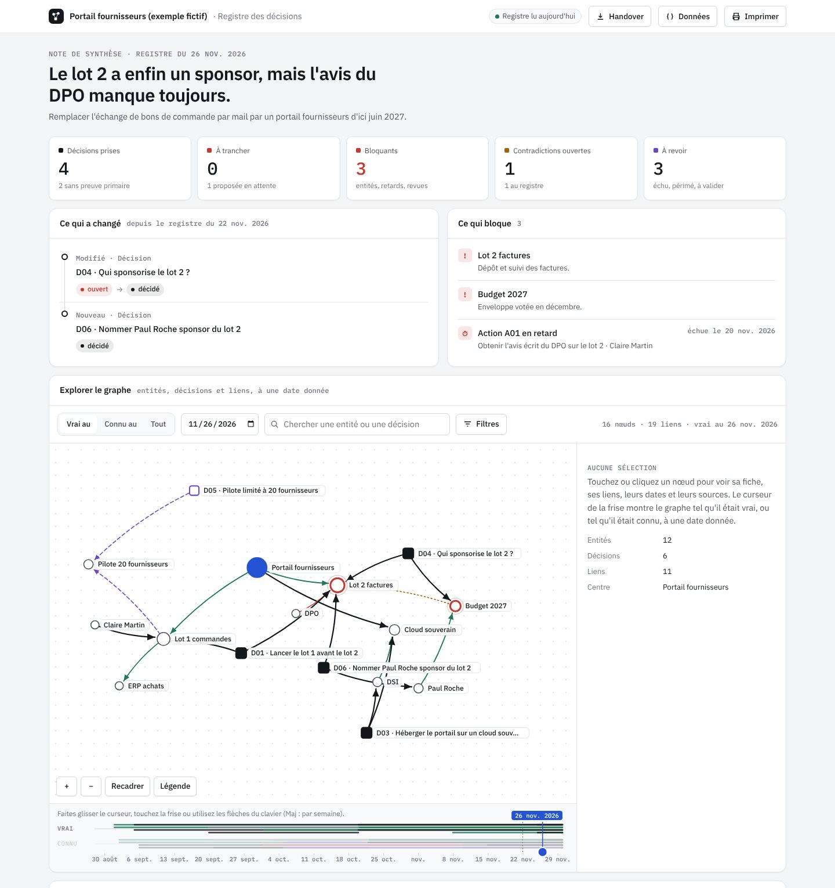
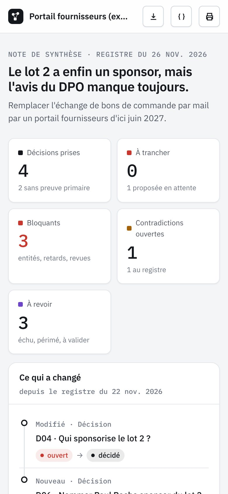
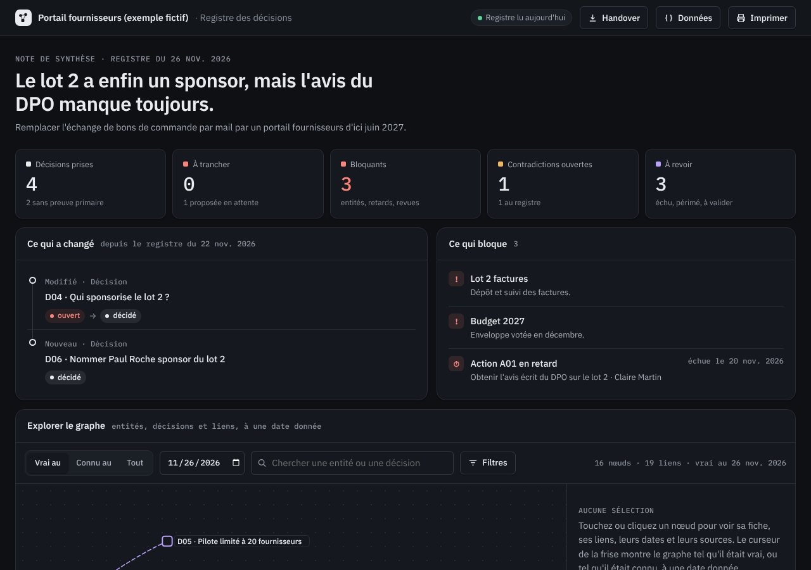

# Registre des décisions pour Claude

Deux skills Claude pour tenir, sur n'importe quel projet, un **registre des décisions daté et bi-temporel** dans Google Drive, et en tirer un **graphe de connaissances en HTML autonome** que n'importe qui peut ouvrir sans Claude, sans compte et sans connexion.

[](LICENSE)  



*Projet fictif fourni en exemple : [`examples/graphe-exemple.html`](examples/graphe-exemple.html). Téléchargez le fichier, ouvrez-le dans votre navigateur.*

## Le problème

Sur un projet qui s'étale sur des semaines, les décisions se prennent dans des chats, des réunions et des mails. Trois choses se perdent :

- **qui a décidé quoi, sur quelle preuve** : une recommandation d'un LLM finit par passer pour une décision ;
- **ce qui a changé** : une décision de septembre annulée en novembre reste dans les esprits comme si elle tenait ;
- **la reprise** : quelqu'un qui arrive sur le projet, ou un autre compte Claude, repart de zéro.

## Ce que font les skills

| Skill | Rôle |
|---|---|
| [`graphe-decisions-projet`](skills/graphe-decisions-projet/SKILL.md) | Construit ou met à jour le registre complet d'un projet (Google Sheet), le graphe HTML, le handover et le diff depuis le passage précédent. |
| [`consigner-decision`](skills/consigner-decision/SKILL.md) | Geste léger : consigne en quelques secondes une décision, une action, un fait ou une correction dès qu'ils apparaissent dans la conversation. |

Principes appliqués à chaque écriture :

- **Le registre fait foi.** Les mémoires de Claude ou de ChatGPT ne sont que des index.
- **Rien ne s'efface, tout se date.** Un changement crée une ligne et clôt l'ancienne.
- **Une synthèse de LLM n'est jamais une preuve.** Chaque élément porte son auteur et son niveau de preuve : primaire, rapporté ou synthèse.
- **`décidé` seulement sur la parole du décideur légitime.** Une recommandation reste `proposé`, même bien accueillie.

## Le modèle bi-temporel

Repris de [Graphiti](https://github.com/getzep/graphiti) (Zep), sans base de graphe ni serveur : quatre colonnes dans une feuille Google Sheets.

| Axe | Colonnes | Répond à |
|---|---|---|
| Temps du monde | `valid_at`, `invalid_at` | Qu'est-ce qui était **vrai** le 15 octobre ? |
| Temps du registre | `recorded_at`, `expired_at` | Qu'est-ce que **le registre savait** le 15 octobre ? |

Les deux diffèrent dès qu'une information est apprise ou corrigée après coup. La page le montre avec une frise à deux couloirs et un curseur que l'on déplace à la souris, au doigt ou au clavier.

## La page HTML

Un seul fichier d'environ 500 Ko, généré par [`build_graph.py`](skills/graphe-decisions-projet/scripts/build_graph.py) à partir du registre :

- **note de synthèse** : constat, compteurs cliquables (décisions prises, à trancher, bloquants, contradictions, à revoir), journal de ce qui a changé ;
- **graphe de forces interactif** : glisser un nœud, survoler pour isoler ses voisins, chercher, filtrer par statut et par niveau de preuve, panneau de détail avec dates et sources ;
- **frise temporelle** « vrai au » et « connu au » ;
- **registre des décisions**, contradictions côte à côte, éléments à revoir, intégrité et couverture, sources ;
- téléchargement du handover (.md) et des données (.json), impression, modes clair et sombre, mobile, clavier.

| Mobile | Sombre |
|---|---|
|  |  |

**Autonome et sûre.** d3 et les polices IBM Plex sont intégrés. Une politique de sécurité de contenu interdit toute requête réseau : la page ne charge rien et n'envoie rien. Le texte du registre est inséré sans jamais être interprété comme du HTML.

**Dans Google Drive.** La page est déposée dans le dossier `05 Graphe et handovers` du projet ; la version précédente part dans `Historique`. Drive n'affiche pas les pages HTML : on télécharge le fichier, puis on l'ouvre dans un navigateur.

## Installation

**Claude Code** (plugin) :

```
/plugin marketplace add DamienDu91/claude-decisions-registry
/plugin install registre-decisions@claude-decisions-registry
```

Les skills s'appellent alors `/registre-decisions:graphe-decisions-projet` et `/registre-decisions:consigner-decision`.

**Application Claude** (claude.ai, bureau, mobile) : compressez chaque dossier de `skills/` en .zip, avec `SKILL.md` à sa racine, puis importez-le dans les réglages de skills de Claude. Sans le dossier `scripts/`, la skill télécharge le générateur à la version figée `v1.2.0` et vérifie ses empreintes SHA-256 avant de l'exécuter.

**Prérequis** : les connecteurs Google Drive et Google Sheets ; Python 3.9 ou plus récent pour le générateur, sans dépendance externe.

## Utilisation

Dans une conversation :

- « Construis le graphe de décisions du projet X à partir de son dossier Drive. »
- « Mets à jour le registre du projet X avec les chats de cette semaine. »
- « Consigne : on part sur l'hébergement souverain, validé par la DSI ce matin. »
- « Programme une mise à jour hebdomadaire du graphe du projet X. »

En ligne de commande, sur l'exemple fourni :

```bash
python3 skills/graphe-decisions-projet/scripts/build_graph.py \
  examples/registre-exemple.json sortie/ \
  --precedent examples/snapshot-precedent.json
```

Sorties : `sortie/graphe.html`, `sortie/graphe.json`, `sortie/handover.md`, et un résumé JSON avec les alertes d'intégrité.

## Format du registre

Un Google Sheet, un onglet par type de ligne : `Config`, `Entités`, `Liens`, `Décisions`, `Faits`, `Actions`, `Contradictions`, `Rôles`, `Sources`, `À valider`, `Journal`, `Snapshots`. Le détail des colonnes est dans [`SKILL.md`](skills/graphe-decisions-projet/SKILL.md#le-registre-google-sheet) ; un exemple complet est dans [`examples/registre-exemple.json`](examples/registre-exemple.json). Le générateur reconnaît les onglets et les en-têtes sans tenir compte des accents ni de la casse.

## Tests

```bash
python3 -m unittest discover -s tests -v
```

Les tests couvrent la lecture des en-têtes, les contrôles d'intégrité et bi-temporels, l'échappement du contenu et l'absence de ressource externe dans la page. Un test navigateur facultatif (`tests/browser_check.py`, Playwright) vérifie le rendu hors ligne, le curseur temporel et les interactions.

## Limites

- Au-delà d'une centaine d'entités, un graphe de forces devient illisible : la skill demande de découper par sous-sujet.
- Le connecteur Drive ne remplace pas le contenu d'un fichier : le lien stable est celui du dossier, pas celui de la page.
- La qualité du registre dépend de la discipline de consignation. Les skills distinguent décidé, proposé et hypothèse ; elles ne remplacent pas le décideur.

## Crédits

- Modèle bi-temporel inspiré de [Graphiti](https://github.com/getzep/graphiti) (Zep, Apache 2.0) et de l'article [*Zep: A Temporal Knowledge Graph Architecture for Agent Memory*](https://arxiv.org/abs/2501.13956).
- Idée de départ : [Graphify](https://pypi.org/project/graphifyy/), qui transforme un dossier en graphe de connaissances.
- Dessin : [d3.js](https://d3js.org) (ISC). Polices : [IBM Plex](https://github.com/IBM/plex) (SIL OFL 1.1). Détail dans [THIRD_PARTY_NOTICES.md](THIRD_PARTY_NOTICES.md).

## Licence

[MIT](LICENSE) © 2026 Damien Duguet

---

## In English

Two Claude skills (in French) that keep a dated, **bitemporal decision log** for any project in Google Sheets, and generate a **self-contained, offline HTML knowledge graph** anyone can open without Claude: briefing, interactive force-directed graph, "true as of" / "known as of" timeline, decision register, contradictions, handover export. Install in Claude Code with `/plugin marketplace add DamienDu91/claude-decisions-registry`. MIT licensed.
